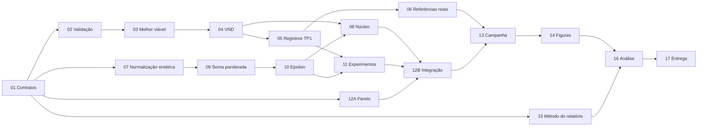

# Backlog executável — Entrega 2

Status: **TP2-01 a TP2-12B autorizadas e implementadas**; TP2-13 a TP2-17
permanecem posteriores. IDs são locais, sem issues publicadas no GitHub.
Este backlog implementa o [planejamento](PLANEJAMENTO.md) e usa os IDs da
[matriz](MATRIZ_REQUISITOS.md). Caminhos relativos à raiz Git, não à pasta `TD`.

## Acompanhamento da execução

| Tarefa | Estado | Evidência |
|---|---|---|
| TP2-01 | Concluída | Commit `2dc9cc1`; 18 testes na suíte após a tarefa |
| TP2-02 | Concluída | Commit `c06409d`; 30 testes na suíte após a tarefa |
| TP2-03 | Concluída | Commit `8056f95`; 37 testes na suíte após a tarefa |
| TP2-04 | Concluída | Commit `becaf2b`; 48 testes na suíte após a tarefa |
| TP2-05 | Concluída | Commit `9ec0844`; 56 testes na suíte após a tarefa |
| TP2-06 | Concluída | Infraestrutura `9b24a81`/`ba8844a`, resultados `1ea4e6c`; 15/15 finais viáveis, seis figuras e relatório corrigido |
| TP2-07 | Concluída | `b55f371` e `dc48ace`; normalização, referências/hash, degeneração e valores externos |
| TP2-08 | Concluída | `124a54b`; 12 testes focais, orçamento interno, observação, mono e ambos métodos TP2 |
| TP2-09 | Concluída | `c4bb7f7`; nove testes, 16 pesos validados e prioridade de viabilidade |
| TP2-10 | Concluída | `ae5f0f3`; tetos independentes, malha 4×4, química e excessos auditáveis |
| TP2-11 | Concluída | `3bf54db` e `241bd64`; agenda 160, manifesto, registros, retomada e proveniência |
| TP2-12A | Concluída | `fa944d4`; 19 testes, arquivo 3D, deduplicação física e origens agregadas |
| TP2-12B | Concluída | `003d9c4` e `8223522`; suíte 162/162, integração 8 runs/4.000 avaliações, auditoria independente e retomada 8/8 |
| TP2-13 a TP2-17 | Pendentes | Fora do escopo autorizado; infraestrutura oficial pronta, campanha completa não executada |

Detalhes dos testes e decisões em [EXECUCAO_01_06.md](EXECUCAO_01_06.md).
As evidências novas, critérios e publicação estão em
[EXECUCAO_07_12.md](EXECUCAO_07_12.md).

Validação da etapa 01–06: 69 testes automatizados, auditoria independente de todas as
composições e conferência dos 14 produtos consolidados. A referência canônica
está em `results/referencias_tp1.json`; os registros e resultados completos,
em `results/tp1_corrigido/`. Os resultados históricos da raiz foram preservados.

Prioridades: P0 desbloqueia correção/modelo; P1 implementa entrega obrigatória; P2 consolida comunicação/pacote, sem significar opcional. Tamanho é relativo: pequeno = uma responsabilidade delimitada; médio = módulo e testes; grande = execução/integracão com várias verificações. Não é estimativa garantida em horas.

Regra de conclusão por issue de código: adicionar teste de comportamento faltante, confirmar falha, implementar, confirmar aprovação dos testes relevantes e revisar diff antes de commit específico. Testes e documentação acompanham o módulo responsável. Não mover ou descartar alterações locais de terceiros.

## Visão e dependências

| ID | Grupo / título resumido | Prioridade | Tamanho | Depende de | Frente |
|---|---|---|---|---|---|
| TP2-01 | Fundamentos — contratos e ambiente reproduzível | P0 | Pequeno | Aprovação deste plano | A |
| TP2-02 | Restrições — validar solução completa | P0 | Médio | 01 | A |
| TP2-03 | Correção — preservar melhor viável TP1 | P0 | Médio | 02 | B |
| TP2-04 | Correção — fixar contrato VND e testar operadores reais | P0 | Médio | 03, para evitar conflito de edição | B |
| TP2-05 | Experimentos — salvar todas as rodadas TP1 | P0 | Médio | 03,04 | E |
| TP2-06 | Fundamentos — regenerar TP1 e referências cruzadas | P0 | Médio | 05 | E+A |
| TP2-07 | Modelagem — normalização empírica validada | P1 | Médio | 01; 06 para referências reais | C |
| TP2-08 | Algoritmo — núcleo GVNS parametrizado | P1 | Grande | 04,07,09,10 | B |
| TP2-09 | Modelagem — soma ponderada e malha | P1 | Médio | 01,07 | C |
| TP2-10 | Modelagem — ε-restrito e malha cartesiana | P1 | Médio | 09, para coordenar arquivo compartilhado | C |
| TP2-11 | Experimentos — agenda, registros e retomada | P1 | Médio | 05,09,10; 08 para integração | E |
| TP2-12A | Pareto — arquivo 3D com proveniência | P1 | Médio | 01 | D |
| TP2-12B | Testes — integração completa dos dois métodos | P1 | Médio | 02,08,11,12A | D |
| TP2-13 | Experimentos — piloto e campanha final auditada | P1 | Grande | 06,11,12B | E |
| TP2-14 | Visualizações — seis projeções e tabelas | P1 | Médio | 11,12A; 13 para versão final | F |
| TP2-15 | Relatório — método cumulativo e correções | P1 | Médio | 01; 04,07,08,09,10 para fechar método | F |
| TP2-16 | Relatório — análise comparativa sustentada | P1 | Médio | 13,14,15 | F+D |
| TP2-17 | Entrega — revisão, reprodução e pacote | P2 | Médio | 14,15,16 | F+A |

TP2-12, citado na matriz, designa o conjunto 12A+12B. Dependências parciais permitem trabalhar com fixtures sintéticas; fechar uma issue exige validar seus consumidores já integrados. TP2-08 depende das fábricas escalares, que são funções puras e não dependem do núcleo: não há ciclo.

## Fundamentos e correções do TP1

### TP2-01 — Congelar contratos mínimos e verificar o ambiente

- **Problema/contexto:** o grupo precisa desenvolver módulos em paralelo; a auditoria não conseguiu importar matplotlib nem rodar pytest.
- **Requisitos:** E02, D01, D07, D08. **Prioridade/tamanho:** P0/pequeno.
- **Incluído:** `contratos.py` conforme §8 do plano; ambiente Python 3.12+ com `requirements.txt`; registro de versões e comando de testes; documentação dos contratos.
- **Fora:** algoritmo novo, troca da estrutura de dados, atualização destrutiva do Git.
- **Arquivos:** `contratos.py`, `requirements.txt` apenas se necessário, README, `tests/test_contratos.py`.
- **Dependências/contratos:** aprovação do plano; produz Solucao, Vetor, Referencia, ConfigEscalar, ConfigBusca, Avaliacao, Candidato, ResultadoBusca.
- **Aceitação:** imports funcionam; configuração rejeita orçamento negativo; valores opcionais distinguem falha e sucesso; requisitos existentes são instaláveis; exclusões locais de PDFs preservadas.
- **Validação:** `python -m pytest -q`; teste de configuração inválida e cópia de composição armazenada sem alias com entrada. Registrar resultado real, sem confundir ausência de dependência com falha do algoritmo.
- **Artefatos:** contratos documentados, ambiente verificado e instruções reproduzíveis.
- **Paralelismo/conflitos:** editor único do contrato; alterações depois do congelamento exigem avisar B–F.

### TP2-02 — Validar a composição inteira antes de avaliar objetivos

- **Problema/contexto:** `validar_estrutura` aceita solução sem pilha 2; dados importados podem ter chaves inválidas.
- **Requisitos:** E03, E05, F01, D07. **Prioridade/tamanho:** P0/médio.
- **Incluído:** conferir exatamente pilhas 1–10, tipos/IDs de minérios, comprimentos, compatibilidade, disponibilidades e qualidade; expor avaliação física conjunta; mensagem útil em entrada inválida.
- **Fora:** reparar solução, alterar dados oficiais, novo objetivo FeT.
- **Arquivos:** `sol_inicial.py`, `avaliacao.py`, `tests/test_avaliacao.py`.
- **Dependências/contratos:** 01; mantém `validar_estrutura(solucao)->(bool,list[str])`; `avaliar` retorna objetivos None para entrada estrutural inválida. Avaliação química pode continuar útil isoladamente para testes existentes.
- **Aceitação:** ausência de qualquer pilha é rejeitada; entrada desconhecida não causa KeyError sem diagnóstico; composição inicial mantém 145 caminhões, f1=60400000, f2≈23.48105481043885 e f3≈14.909887547238732.
- **Validação:** teste `test_pilha_ausente_rejeitada` falha antes da correção; incluir pilha extra, minério inexistente, massa errada, mínimo/máximo, compatibilidade e tolerâncias químicas 0/5e-10/2e-9.
- **Artefatos:** avaliador físico e testes com valores independentes.
- **Paralelismo/conflitos:** C/D podem trabalhar sobre contratos; B aguarda o avaliador. Somente A modifica validação neste passo.

### TP2-03 — Preservar e retornar a melhor solução viável do TP1

- **Problema/contexto:** melhor fitness não garante melhor solução viável nem que uma viável visitada seja guardada.
- **Requisitos:** F01, F03, E01, E06. **Prioridade/tamanho:** P0/médio.
- **Incluído:** incumbente viável separada por objetivo bruto; observação de todos os candidatos avaliados em SHAKE/VND; cópia defensiva; status explícito quando nenhuma viável foi encontrada; adaptar retorno e consumidores mínimos.
- **Fora:** nova normalização TP2, troca da penalidade histórica, prometer encontrar viável em toda execução.
- **Arquivos:** `vns.py`, `tests/test_melhor_viavel.py`.
- **Dependências/contratos:** 02; consumir Avaliacao/Candidato/ResultadoBusca; guardar melhor viável antes de aceitar/rejeitar por fitness. A interface mono retorna ResultadoBusca ou adaptador explicitamente documentado, sem tupla ambígua de sucesso.
- **Aceitação:** uma viável visitada e rejeitada pelo fitness continua elegível para retorno; visita posterior inviável não a substitui; falha retorna `melhor_viavel=None`, sem inventar objetivo final válido.
- **Validação:** trajetória controlada com viável melhor e inviável de menor fitness; candidata encontrada dentro de busca local; candidato mutado depois do armazenamento não altera incumbente; orçamento zero/sem iterações não aparece como sucesso.
- **Artefatos:** retorno corrigido e regressões do feedback.
- **Paralelismo/conflitos:** serializar com 04 e 08, que também editam o núcleo.

### TP2-04 — Documentar o VND real e testar N2/N3 usadas na busca

- **Problema/contexto:** descrição do avanço após cinco reinícios diverge do código; testes atuais não cobrem operadores rápidos.
- **Requisitos:** F04, E04, E05, E17. **Prioridade/tamanho:** P0/médio.
- **Incluído:** preservar regra atual; corrigir comentário em `vnd`; criar especificação de sequência; testar variantes rápidas, limite de tentativas e não mutação; registrar observações para editor do relatório.
- **Fora:** redesenhar N3 ou mudar comportamento VND sem decisão explícita.
- **Arquivos:** `vns.py`, `tests/test_vnd.py`, `tests/test_vizinhos_rapidos.py`, notas para `relatorio.tex` em `docs/tp2/`.
- **Dependências/contratos:** 03; geradores `(solucao,rng)->Solucao|None` mantidos.
- **Aceitação:** após quinto reinício, melhoria em N2 chama N2 novamente; sem melhoria avança N3; antes do limite melhoria volta N1. N3 modifica duas posições e contagens da pilha; N2 preserva uso global e compatibilidade cruzada.
- **Validação:** geradores controlados registram sequência; mesma seed repete; nenhuma entrada é alterada; RNG controlado força movimentos inválidos e esgotamento de tentativas.
- **Artefatos:** testes dos operadores reais e contrato VND verificável.
- **Paralelismo/conflitos:** editor B; F aplica a redação no relatório em 15 para evitar edições simultâneas.

### TP2-05 — Persistir e validar cada execução mono-objetivo

- **Problema/contexto:** log histórico só valida a campeã; faltam composições/objetivos cruzados e falhas podem entrar nas estatísticas.
- **Requisitos:** E02, E06, E07, F02, D08. **Prioridade/tamanho:** P0/médio.
- **Incluído:** `registros.py`, um JSON por execução, resumo CSV, todos os campos do contrato, curva melhor viável e diagnóstico, estatísticas de viáveis com contagem de falhas; regeneração das seis figuras TP1 a partir dos registros.
- **Fora:** executar campanha final TP2 ou sobrescrever `resultados_vns.txt` histórico sem preservar versão.
- **Arquivos:** `registros.py`, consumidor experimental em `vns.py`, `tests/test_registros.py`, saída `results/tp1_corrigido/`.
- **Dependências/contratos:** 03/04; ResultadoBusca; definir `salvar_resultado(resultado,metadados,path)` e `ler_resultado(path)` como serialização v1, com revalidação da composição carregada.
- **Aceitação:** cinco rodadas geram cinco registros mesmo se uma falhar; os três objetivos são salvos por solução; tempo é descrito como decorrido; falha não vira zero nem entra como melhor objetivo bruto.
- **Validação:** fixture com quatro sucessos e uma falha; min/std/max só dos válidos e denominador n-1 informado; zero/um sucesso não divide por zero; round-trip preserva chaves inteiras e números.
- **Artefatos:** esquema v1, registros completos, tabelas e gráficos reproduzíveis.
- **Paralelismo/conflitos:** coordenar pequena edição de `vns.py` com B; E é dono de persistência/experimentos.

### TP2-06 — Reexecutar TP1 e construir a base de referências

- **Problema/contexto:** mínimos impressos não bastam para normalização rastreável; composição não pode ser recuperada com segurança dos gráficos.
- **Requisitos:** E03, E06, E07, E10, D02. **Prioridade/tamanho:** P0/médio.
- **Incluído:** 15 buscas com seeds oficiais, revalidação dos arquivos, tabela 15×3, matriz 3×3 das melhores por objetivo, referências min/max de colunas e suas origens; atualizar resultados TP1 cumulativos.
- **Fora:** usar solução inviável para ampliar intervalo ou declarar mínimos globais.
- **Arquivos:** `results/tp1_corrigido/`, `results/referencias_tp1.json`, rotina de referência em `normalizacao.py` em coordenação com C.
- **Dependências/contratos:** 05; produz Referencia com ID/hash e origens para 07. Pode construir JSON por consumidor da função de 07 sem bloquear testes sintéticos de C.
- **Aceitação:** 15 registros e composições válidos; extremos apontam para execuções existentes; três melhores escolhidas só entre viáveis; uma falha impede congelar referência oficial até resolução documentada.
- **Validação:** recomputar objetivos/viabilidade das composições; comparar estatísticas e seis figuras com arquivos novos; diferenças ante histórico explicadas, não forçadas a coincidir.
- **Artefatos:** referência empírica auditada e resultados TP1 corrigidos.
- **Paralelismo/conflitos:** execução E, revisão A; C usa dados sintéticos até referência real ficar pronta.

## Modelagem e algoritmo multiobjetivo

### TP2-07 — Implementar normalização com referências congeladas

- **Problema/contexto:** objetivos têm escalas distintas; λ atual não normaliza.
- **Requisitos:** E10, F01, D02. **Prioridade/tamanho:** P1/médio.
- **Incluído:** `normalizar`, validação de Referencia, leitura/construção min–max e origem; sem clipping; erro explícito para amplitude degenerada.
- **Fora:** alterar referência durante busca, usar aproximação de nadir como valor exato, maximizações extras.
- **Arquivos:** `normalizacao.py`, `tests/test_normalizacao.py`.
- **Dependências/contratos:** 01 para tipos; 06 só para teste real/final. Produz `normalizar(Vetor,Referencia)->Vetor` e `construir_referencia(candidatos_viaveis)->Referencia`.
- **Aceitação:** mínimo mapeia a 0, máximo a 1; valores externos permanecem externos; arquivo conserva hash/origem; valor não finito ou intervalo degenerado é rejeitado.
- **Validação:** referência a=(10,2,4), b=(20,6,8): x=(15,4,6) resulta (0.5,0.5,0.5); x=(5,8,10) resulta (-0.5,1.5,1.5). Testar denominador zero e limiar relativo 1e-12.
- **Artefatos:** normalizador e referências rastreáveis; seção matemática fornecida a F.
- **Paralelismo/conflitos:** independente de B/D; coordenar publicação dos arquivos reais com E em 06.

### TP2-08 — Parametrizar GVNS com avaliação, observação e orçamento

- **Problema/contexto:** `vns.py` assume um nome de objetivo e mistura busca/figuras; novos métodos precisam do mesmo núcleo verificável.
- **Requisitos:** E04, E05, F01/F03, D04/D05/D06. **Prioridade/tamanho:** P1/grande.
- **Incluído:** extrair núcleo para `busca.py`; `resolver` do plano; modo mono compatível, prioridade de viabilidade TP2, contador central, término propagado, melhor viável e callback de candidatos; VND igual ao contrato 04.
- **Fora:** otimização incremental/cache, novos operadores, população evolutiva, mudança dos dados.
- **Arquivos:** `busca.py`, `avaliacao.py` em coordenação com A, adaptador `vns.py`, `tests/test_busca.py`.
- **Dependências/contratos:** 04,07,09,10; usa `avaliar`, ConfigBusca e callback `(Candidato)->None`; não depende de implementação interna do arquivo Pareto.
- **Aceitação:** viável sempre preferida à inviável na comparação TP2; entre inviáveis menor V; entre viáveis menor escalar/desempate. SHAKE preserva estrutura; orçamento vale em todos os loops; callback ocorre antes da aceitação.
- **Validação:** casos controlados de orçamento 0/1/pequeno, melhoria no último candidato, nenhuma viável, melhor viável rejeitada pela trajetória mono, continuidade do contrato VND. Mesma seed/configuração repete solução e contadores (tempo excluído).
- **Artefatos:** núcleo comum e adaptador mono sem perder funcionalidades.
- **Paralelismo/conflitos:** B editor exclusivo do núcleo; A fornece avaliador, C fornece escalares e D desenvolve arquivo independentemente.

### TP2-09 — Implementar soma ponderada e seus 16 pesos

- **Problema/contexto:** falta a primeira abordagem obrigatória e a variação de preferências.
- **Requisitos:** E08, E11, D03. **Prioridade/tamanho:** P1/médio.
- **Incluído:** função escalar pura, validação dos pesos, fábrica de configurações H=4 mais centro, desempate conforme plano.
- **Fora:** penalidade como normalização, pesos adaptativos, chamar busca dentro da função escalar.
- **Arquivos:** `escalarizacoes.py`, `tests/test_ponderada.py`.
- **Dependências/contratos:** 01/07; `valor_ponderado(g:Vetor,pesos:Vetor)->float`; `configuracoes_ponderadas()->list[ConfigEscalar]` com IDs estáveis.
- **Aceitação:** exatamente 16 configurações distintas, inclui três vértices e centro; todos os pesos não negativos e soma 1; entradas inválidas rejeitadas.
- **Validação:** g=(0.2,0.4,0.6), w=(0.5,0.25,0.25) resulta 0.35; peso negativo, vetor zero, NaN e soma fora de tolerância falham; peso zero não elimina a necessidade de Pareto 3D.
- **Artefatos:** escalarização, malha e descrição de justificativa para relatório.
- **Paralelismo/conflitos:** C coordena 09 e 10 no mesmo arquivo; B integra depois.

### TP2-10 — Implementar ε-restrito com dois limites independentes

- **Problema/contexto:** custo minimizado deve respeitar tetos de ambos os desvios normalizados, além das faixas originais.
- **Requisitos:** E09, E11, D03/D04. **Prioridade/tamanho:** P1/médio.
- **Incluído:** custo principal g1, verificação dos dois ε, excesso normalizado e desempate; malha cartesiana de 16 pares; parâmetros fixos durante busca.
- **Fora:** provar inviabilidade, otimizar apenas diagonal, substituir faixas por limites agregados.
- **Arquivos:** `escalarizacoes.py`, contribuição ao `avaliacao.py` via A, `tests/test_epsilon.py`.
- **Dependências/contratos:** 09; `restricoes_epsilon(g:Vetor,eps:tuple[float,float],tol=1e-9)->tuple[bool,float]`; `configuracoes_epsilon()->list[ConfigEscalar]`.
- **Aceitação:** par (1/3,1) está presente; 16 pares únicos; violar qualquer teto invalida o candidato para aquela configuração; custo é o escalar e desempate não mascara pior custo.
- **Validação:** cenários U=(0.2,0.8,0.2), V=(0.5,0.2,0.8), W=(0.6,0.4,0.4): (0.8,0.8) permite U/V/W e escolhe U pelo custo; (0.4,0.4) permite só W; (0.2,0.2) permite nenhum. Testar limites exatos/tolerância e qualidade física inválida com ε satisfeito.
- **Artefatos:** fábrica/avaliador ε e casos didáticos reproduzíveis.
- **Paralelismo/conflitos:** C edita escalares, A integra qualidade; não alterar núcleo de B.

### TP2-12A — Criar arquivo não dominado tridimensional com proveniência

- **Problema/contexto:** não há identificação de não dominadas nem deduplicação de composições.
- **Requisitos:** E13, D06/D07. **Prioridade/tamanho:** P1/médio.
- **Incluído:** `domina`, `chave_solucao`, `atualizar_arquivo`; composição canônica por pilha; origens múltiplas; filtragem por repetição e método.
- **Fora:** inferir dominância em duas dimensões, truncar arquivo, hipervolume, garantir fronteira verdadeira.
- **Arquivos:** `pareto.py`, `tests/test_pareto.py`.
- **Dependências/contratos:** 01; consome Candidato com avaliação viável; rejeita candidato não viável; tipos/assinaturas do plano.
- **Aceitação:** apenas 3D rege arquivo; adicionar dominador remove dominados; duplicata física agrega origens e não duplica composição; vetores iguais de composições distintas são preservados.
- **Validação:** A=(1,2,3) domina B=(2,3,4), é incomparável com C=(0,4,2); A não domina D=(2,3,1) apesar de parecer melhor na projeção f1×f2. Testar lista vazia, cópia defensiva, inserção em ordem distinta, permutação interna e origens de duas seeds.
- **Artefatos:** arquivo Pareto e testes independentes do núcleo de busca.
- **Paralelismo/conflitos:** pode começar imediatamente após 01 em paralelo com B/C/E; D não edita `busca.py`.

## Experimentos, integração e visualização

### TP2-11 — Orquestrar cinco varreduras por abordagem e salvar a campanha

- **Problema/contexto:** cinco execuções não significam cinco pontos; cada repetição precisa percorrer todas as configurações com rastreabilidade.
- **Requisitos:** E02, E11/E12/E16, F02, D05/D08. **Prioridade/tamanho:** P1/médio.
- **Incluído:** agenda de 160 runs, seeds derivadas SHA-256, manifestos, esquema v1, retomada segura, CSV/JSON e callback Pareto por repetição; CLI de experimentos.
- **Fora:** paralelismo distribuído automático, escolher seeds por sucesso, reutilizar resultado com referência alterada.
- **Arquivos:** `experimentos.py`, `registros.py`, `configs/tp2.json`, `tests/test_experimentos.py`.
- **Dependências/contratos:** 05,09,10; 08 para integrar; consumidor de 12A. `executar_campanha(config_path,output_dir)->dict` chama `resolver` e registra inclusive falhas.
- **Aceitação:** 2×5×16 IDs únicos; mesma agenda independe da ordem de execução; cada registro tem composição/validação ou ausência explícita; arquivos parciais nunca contam como run concluído.
- **Validação:** solver simulado retorna sucessos/falhas; interrupção e retomada não duplicam; hash alterado invalida reaproveitamento; outra ordem produz mesmas seeds; formatos recarregados preservam chaves e precisão.
- **Artefatos:** configuração completa, manifesto, registros e instruções CLI.
- **Paralelismo/conflitos:** E; B expõe solver, D expõe Pareto, C fornece listas; não duplicar schemas em módulos diferentes.

### TP2-12B — Validar integração, retornos e arquivos dos dois métodos

- **Problema/contexto:** módulos corretos isoladamente podem combinar viabilidade ε, arquivo e retorno de forma errada.
- **Requisitos:** E04, E12/E13, F01/F02/F03/F04, D07. **Prioridade/tamanho:** P1/médio.
- **Incluído:** campanha reduzida dos dois métodos, múltiplas seeds, cenários viáveis/inviáveis controlados e revalidação da persistência; revisão dos contratos.
- **Fora:** campanha oficial completa ou novos mecanismos de busca.
- **Arquivos:** `tests/test_integracao_tp2.py`, fixtures pequenas de referência/composição; correções pertencem aos módulos de origem com coordenação.
- **Dependências/contratos:** 02,08,11,12A; usa APIs públicas sem chamar implementações privadas como oráculo.
- **Aceitação:** todo ponto exportado satisfaz estrutura/qualidade/ε de origem; falha fica no resumo, não no Pareto; origem preservada ao consolidar repetições; melhor viável retornada foi observada.
- **Validação:** recomputar objetivos e restrições a partir da composição; incluir vetor melhor em f1/f2 mas pior em f3; execução sem viável não apaga resultados prévios; mesma seed/configuração repete saída numérica.
- **Artefatos:** teste de ponta a ponta e relatório de validação antes da campanha.
- **Paralelismo/conflitos:** D revisa integração; qualquer correção no núcleo deve ser combinada com B.

### TP2-13 — Executar piloto e campanha oficial com auditoria dos resultados

- **Problema/contexto:** ainda não se conhece custo/efetividade das malhas; resultados exigem cinco repetições completas.
- **Requisitos:** E12/E13/E18, D05/D08. **Prioridade/tamanho:** P1/grande.
- **Incluído:** piloto fora das seeds oficiais, decisão de orçamento, congelamento de código/configuração/referência; 160 buscas finais; revalidação, contagens, extremos e cobertura direcional.
- **Fora:** inferência estatística não planejada, apagar falhas, substituir seed ruim por seed boa, misturar piloto com resultados oficiais.
- **Arquivos:** `results/piloto/`, `results/tp2/`, `configs/tp2.json`, registro de decisão `docs/tp2/PROTOCOLO_EXPERIMENTAL.md`.
- **Dependências/contratos:** 06,11,12B. Piloto usa teto proposto de 10.000 avaliações e seeds 90001/90002; teto final pode mudar com justificativa antes de congelar.
- **Aceitação:** lista esperada de runs integralmente contabilizada; parâmetros iguais entre repetições; nenhum ponto inviável publicado; arquivos e métricas revalidados por segunda pessoa; tempo/avaliações/fracassos registrados.
- **Validação:** conferir 160 IDs, 5 repetições/método, 16 configurações/repetição; reabrir todas as soluções; recalcular ND; C(A,B) com denominador vazio retorna N/A, não zero inventado.
- **Artefatos:** dados finais, resumos, logs e protocolo assinado pelo grupo no sentido de revisão registrada.
- **Paralelismo/conflitos:** execução E; revisão A/D. Se distribuir execuções, usar shards disjuntos e manifests idênticos; não sobrescrever diretório compartilhado em concorrência.

### TP2-14 — Gerar seis projeções e tabelas diretamente dos dados

- **Problema/contexto:** o TP2 exige visualização separada das duas abordagens com identificação das cinco repetições.
- **Requisitos:** E14/E15/E16/E18. **Prioridade/tamanho:** P1/médio.
- **Incluído:** três pares de objetivos por método, identidade visual de seed consistente, proveniência múltipla explícita, eixos originais e tabelas descritivas; dados TP1 como comparação rotulada separadamente.
- **Fora:** escolher solução final multicritério, criar dashboard/Streamlit, esconder conjuntos vazios.
- **Arquivos:** `figuras_tp2.py`, `figures/tp2/`, tabelas geradas para LaTeX, `tests/test_figuras_dados.py`.
- **Dependências/contratos:** 11/12A para fixtures; 13 para fechar entrega. Lê arquivos consolidados e não executa nova busca.
- **Aceitação:** exatamente seis painéis obrigatórios, cada qual rotulado com método/par; legenda das cinco repetições ou indicação de ausência; todos os pontos vêm do ND 3D consolidado, não de filtragem 2D.
- **Validação:** fixture com ponto compartilhado por duas repetições e conjunto vazio; contagem de dados bate com arquivo; inspeção visual sem sobreposição de legendas, símbolos distinguíveis e mesmas escalas por par entre métodos.
- **Artefatos:** figuras PNG/PDF e tabelas regeneráveis, com comando e origem dos dados.
- **Paralelismo/conflitos:** F desenvolve sobre fixture enquanto E executa; não editar números manualmente em LaTeX.

## Relatório e entrega

### TP2-15 — Revisar TP1 e escrever método multiobjetivo no relatório cumulativo

- **Problema/contexto:** relatório atual promete viabilidade e descreve VND de modo incompatível com o código; falta todo o método TP2.
- **Requisitos:** E01/E03/E08/E09/E10/E11/E17, F01–F04. **Prioridade/tamanho:** P1/médio.
- **Incluído:** revisão de §§4–8 antigos, formulação escalar, referências empíricas, pesos/ε justificados, pseudocódigo integrado, melhor viável/arquivo, política de inviabilidade, parada e protocolo; corrigir p.p.²/tempo decorrido e N1.
- **Fora:** afirmar resultados ainda não coletados, segundo relatório independente, slides TP2.
- **Arquivos:** `relatorio.tex`, referências/tabelas metodológicas geradas; notas de revisão em `docs/tp2/`.
- **Dependências/contratos:** começar com 01/plano; fechar após 04,07,08,09,10; inserir dados finais em 16.
- **Aceitação:** conteúdo relevante TP1 preservado e corrigido; política descrita corresponde a cada modo (penalidade TP1, prioridade TP2); ausência de solução viável explicitada; não chamar min/max empíricos de extremos globais.
- **Validação:** revisão linha a linha dos pseudocódigos contra contratos/código; checar que toda decisão de E17 está descrita; formulações mantêm todas as restrições físicas. Compilar prévia sem placeholders de resultados apresentados como fatos.
- **Artefatos:** método cumulativo revisado e pronto para resultados finais.
- **Paralelismo/conflitos:** F editor único de `relatorio.tex`; demais frentes entregam texto/figuras em arquivos auxiliares ou comentários de revisão.

### TP2-16 — Analisar compromissos e variabilidade entre abordagens

- **Problema/contexto:** gráficos sem interpretação não atendem a comparação pedida.
- **Requisitos:** E15/E18, E01. **Prioridade/tamanho:** P1/médio.
- **Incluído:** regiões por repetição, comparações bidirecionais, custo versus desvios, resultados ε sem viável, relação com referências TP1, limitações da heurística e da malha.
- **Fora:** selecionar ação final pelo TP3, declarar superioridade só por cardinalidade, garantir frente exata.
- **Arquivos:** seção de resultados em `relatorio.tex`, tabelas/figuras 14.
- **Dependências/contratos:** 13,14,15; números vêm de registros congelados.
- **Aceitação:** responde explicitamente se repetições alcançaram regiões semelhantes; compara métodos com esforço efetivo; cada afirmação numérica aponta a tabela/figura; divergências e fracassos não são omitidos.
- **Validação:** outro integrante confere amostra de números e conclusões; distinção entre incomparabilidade, dominância e empate; cinco resultados por abordagem discutidos sem transformar 160 subproblemas em 160 repetições independentes.
- **Artefatos:** análise final e discussão de limitações dentro do relatório cumulativo.
- **Paralelismo/conflitos:** D revisa análise produzida por F; uma pessoa aplica mudanças no LaTeX.

### TP2-17 — Conferir conformidade, reproduzir e empacotar entrega

- **Problema/contexto:** resultados e documentação precisam chegar juntos e refletir a mesma versão.
- **Requisitos:** E01/E02/E16/E17 e verificação final de E01–E18/F01–F04. **Prioridade/tamanho:** P2/médio, obrigatório.
- **Incluído:** README real atualizado, comandos testados, dependências, arquivos de configurações/referências/resultados/figuras, relatório compilado, checklist da matriz; indicar histórico desatualizado em `TD/README.md` sem reescrever registros antigos como se fossem atuais.
- **Fora:** publicação/entrega na plataforma sem instrução, adicionar exclusões locais de aulas ao commit, slides/Streamlit.
- **Arquivos:** README, requirements, `relatorio.pdf`, manifesto de entrega e pacote em `dist/`; arquivos auxiliares `.aux/.log` não entram.
- **Dependências/contratos:** 14,15,16 e todos os testes obrigatórios; paths dos comandos devem existir e funcionar.
- **Aceitação:** novo checkout/ambiente reproduz campanha ou replay completo das figuras e valida dados, com escopo de reprodução declarado; código/data hash corresponde ao relatório; matriz final possui evidência para cada obrigação; PDF visualmente legível.
- **Validação:** suíte completa, verificador de composições, regeneração de tabelas/figuras, compilação LaTeX, leitura visual de todas as páginas; inspecionar conteúdo do pacote e diff para não incluir arquivos indevidos. Se campanha não for reexecutada inteira, registrar essa limitação e não alegar reprodução integral.
- **Artefatos:** pacote de entrega, relatório cumulativo, README e checklist final conferidos.
- **Paralelismo/conflitos:** integrador A com F; congelar código durante montagem. Envio final permanece sob controle do grupo.

## Critério de revisão deste backlog

- [ ] Grupo aprova arquitetura, malhas, política de inviabilidade e referência propostas.
- [ ] Responsáveis assumem frentes e combinam editores de arquivos compartilhados.
- [ ] Horário do prazo de 18/10 é conferido na disciplina.
- [ ] Cada issue é publicada, se desejado, preservando escopo/aceitação/dependências acima; atualizar IDs locais com links reais depois da publicação.
- [ ] Antes de desenvolver, nenhuma obrigação E/F permanece sem responsável no plano.

Não criar issue genérica “implementar multiobjetivo”: a integração é TP2-12B, dependente dos módulos delimitados. Nenhuma das questões de aprovação aqui autoriza automaticamente implementação ou publicação externa.
